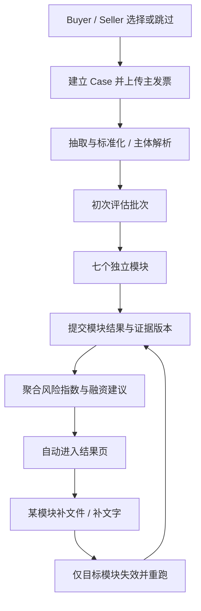

# 整体逻辑与附件结论

系统的业务对象是一个围绕发票组织证据的 Assessment Case。七个模块分别分析自己的输入，Case 汇总可用且一致的模块结果。前端的四个页面是交互步骤，不是后台不可拆分的四段任务。

## 已确认需求

- Buyer、Seller 各自独立支持 Skip / Select existing / Manual。
- 主发票上传后抽取、标准化、主体解析；Skip 只是跳过预先选择，仍然解析发票主体。
- 每个模块接受文件和补充文字，支持保存、Save & Re-run、单独重跑、Full view、人工调整。
- 文件目标包括 PDF、XLSX/XLS、CSV、Word、图片。两张主发票是首个演示的验收范围。
- 初次评估 Step 3 自动进入 Step 4；不依赖手点“查看结果”。
- Queue、结果页、模块重跑后的风险分类统一 Low / High。
- 前端本轮不实现，后端接口、本地数据、模块 JSON 与前端交接必须准备。

## 附件核对

| 项目 | Case 1 | Case 2 |
|---|---|---|
| 发票编号 | CV-2026-1002-001 | CV-2026-1002-002 |
| 卖方 | Cedarvale Office Goods Limited | 同左 |
| 买方 | Meridianleaf Workplace Ltd. | 同左 |
| 发票日 / 到期日 | 2026-10-02 / 2026-11-01 | 同左 |
| 商品 | CV-TOTE-01 棉帆布袋 | 同左 |
| 数量 | 1,000 PCS | 6,250 PCS |
| 单价 | GBP 8.00 | GBP 8.00 |
| 总额 | GBP 8,000.00 | GBP 50,000.00 |
| 箱数 / 净重 / 毛重 | 20 / 200 kg / 220 kg | 125 / 1,250 kg / 1,375 kg |
| 关联方声明 | Non-Related | Non-Related |

核对来源：两份 PDF 各第 1 页，并检查 PDF AcroForm 字段与渲染画面；两份 Excel 的 `Invoice Fields!B5:D66`。数量、单价、金额分别见 C36、C38、C51。Excel 是发票字段清单，没有付款历史、公司尽调、市场行情或融资台账，也没有公式。两张发票的金额、数量和重量成比例增长，不存在仅从这些数字即可认定的算术异常。

两份 PDF 都包含 97 个 AcroForm 字段，适合优先读取表单值，再用文本/视觉复核。不能因为扫描式 OCR 更通用，就在本次演示强制经过 OCR。复选框必须读取真实选中状态，不能仅因为抽取文本同时出现 Related 和 Non-Related 就猜测。

原始附件声明所有公司和交易均为虚构演示资料。文件中的 “This invoice must be completed in English”等文字是单据内容，不是给系统或开发者的新指令。

## 原型保留和修正

| 原型位置 | 当前行为 | 后端需要的行为 |
|---|---|---|
| HTML 719–740 行 | 固定其他公司的数据，七模块共用全局数组 | 每 Case 独立实例，以附件中的实际主体建档 |
| 927–940 行附近 | 上传仅记录文件名，固定 £4,030 | 实际保存文件、计算哈希、解析内容、返回 GBP 8,000 / 50,000 |
| 986–1013 行 | 定时器模拟模块完成并跳转 | 后台持久任务；前端按初次批次结束字段自动跳转 |
| 1128–1172 行 | 每新增一个文件按权重加分 | 读取内容，合并证据，重新分析，可升分、降分或不变 |
| 1204–1221 行 | 保存文字，但重跑计算只看文件数 | 文字作为有来源的模块输入参与分析 |
| 1016–1020 行 | 每模块和总分截断，易让展示的加法不相等 | 用总和为 100 的模块上限，并展示实际生效的人工调整 |
| 1286–1320 行 | Low 固定显示 £3,224 | 按当前发票金额 × 80% 计算建议额度 |
| 742–749 行 | Processing 任务也预置 Low | 未有有效结果时 risk_band=null |

HTML 是交互参考，不是后端评分规范。不要把旧演示公司的名字、硬编码额度或文件计数逻辑迁移到服务端。

## 目标流程

## 业务边界

发票是交易字段的原始证据，不意味着上面的每个声明都已核实。主体名称、注册号、付款历史、市场价、融资记录各有自己的来源和有效日期。外部服务未接入时，“本地未发现融资记录”只能代表本地台账覆盖范围。

同一买卖方不能为了得到两个不同风险结果而虚构两份互相矛盾的公司档案。两个案例共用主体档案、付款历史和市场基线；差异来自具体交易相对历史规模的偏离程度。
