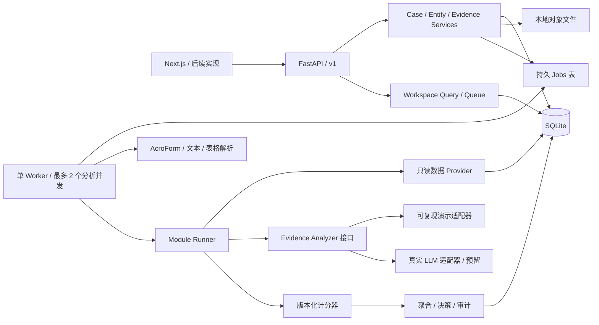

# 系统架构

建议采用模块化单体：一个 FastAPI API 进程、一个本地 Worker、一个 SQLite 数据库和一个文件目录。七个业务模块是代码及任务边界，当前无需拆成七个网络服务。

FastAPI 的 OpenAPI/JSON Schema 支持适合生成明确的前端契约，Python 也便于处理 PDF、表格与 AI 输入。本选择是结合本项目约束的工程判断。[FastAPI 官方功能说明](https://fastapi.tiangolo.com/features/)



## 服务职责

| 组件 | 负责 | 明确边界 |
|---|---|---|
| CaseService | Case、初次批次、队列、公共字段修订 | 不执行 LLM |
| EntityResolver | 选择上下文与发票主体对照、关联记录 | 不把名字相似等同为已验证 |
| EvidenceService | 文件和文字、去重、解析状态、作用范围 | 不按文件数量计分 |
| ModuleRunner | 输入快照、运行、重试、版本竞争检查 | 不重跑无关模块 |
| DataProvider | 按实体/发票标识检索本地记录 | 不允许模型任意生成 SQL |
| EvidenceAnalyzer | 证据中的结构化事实、风险发现、引用 | 不返回最终融资批准 |
| ScorePolicy | 将验证后的发现映射到风险分 | 唯一计分实现 |
| AggregateService | 总分、Low/High、决策可用性、快照 | 不把缺资料当 0 分 |
| AuditService | 谁在何时做什么、使用哪些版本 | 历史追加，不覆盖 |

## 推荐实现布局

```text
backend/
  app/main.py
  app/api/v1/{cases,entities,modules,files,jobs}.py
  app/domain/{states,scoring,aggregation,dependencies}.py
  app/services/{case_service,evidence_service,module_runner}.py
  app/providers/{local_data,demo_analyzer,llm_analyzer}.py
  app/parsers/{pdf_form,pdf_text,excel,csv,docx,image_ocr}.py
  app/db/{models,repositories,session}.py
  app/worker.py
  migrations/
  tests/
  pyproject.toml
```

这些路径是后续实现建议，本包不冒充已经存在的后端。

## 运行选择

- API 监听 `127.0.0.1:8000`，前端后续使用 `localhost:3000`。
- SQLite 开启 foreign_keys、WAL、busy_timeout；数据库和文件放同一台本地磁盘。
- API 与 Worker 通过 Jobs 表交接任务。单 Worker 可以顺序处理任务，界面仍然表现为多个独立模块；独立性不依赖物理并发。
- 如启用分析并发，限制为 2，长解析/LLM 工作在事务外执行，写入时使用短事务。
- 请求提交持久任务后返回 202。原生 BackgroundTasks 可用于非关键小任务；本评估任务要求重启后能恢复，所以以数据库作任务事实来源，而非只存在内存里。[FastAPI BackgroundTasks](https://fastapi.tiangolo.com/tutorial/background-tasks/)
- SQLite WAL 可以让读取与写入更好地并行，但仍需管理写锁，且不适合网络文件系统上的共享数据库。[SQLite WAL 文档](https://www.sqlite.org/wal.html)
- 首版用每 1 秒轮询；事件日志已预留，SSE 可以后续追加，无需同时实现 WebSocket。

## 演进路径

本地演示之后，数据库 Repository 可切至 PostgreSQL，文件 Provider 切至对象存储，Jobs 执行器切至专门的任务队列。HTTP 契约、模块键和评分字段尽量保持不变。不要为两个案例引入 Kubernetes、向量数据库或微服务。

依赖主版本建议：Python 3.11+、FastAPI、Pydantic v2、SQLAlchemy 2、Alembic、Uvicorn。实施时实际安装并锁定经过测试的版本；本包不宣称某个版本“最新”。Pydantic 可生成 JSON Schema，后续服务应对照本包契约，避免手工模型和文档长期分叉。[Pydantic JSON Schema](https://pydantic.dev/docs/validation/latest/concepts/json_schema/)
