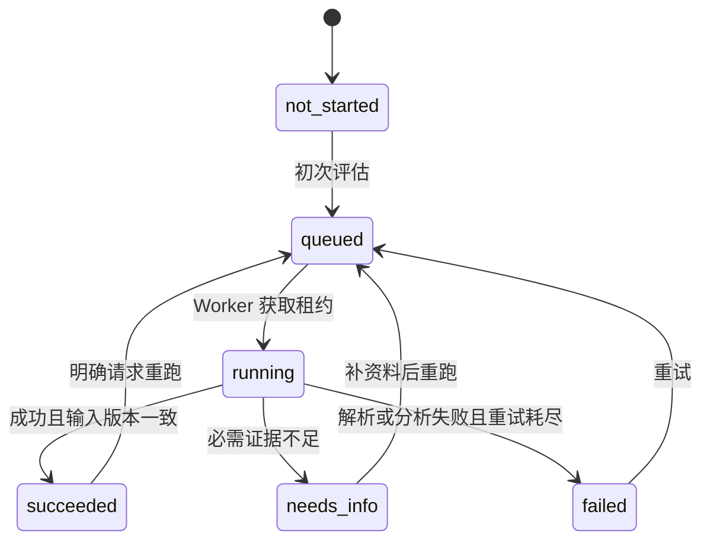

# 状态机与局部重跑

## 不同含义的状态分别保存

| 字段 | 值 | 表达什么 |
|---|---|---|
| case.stage | draft / extracting / resolving / assessing / result | 用户当前业务阶段 |
| case.initial_assessment_status | not_started / running / settled | 初次批次是否已结束 |
| module.state | not_started / queued / running / succeeded / needs_info / failed | 执行状态 |
| module.freshness | none / current / stale | 已保存输出是否覆盖当前输入 |
| module.adjustment_status | none / active / pending_review | 人工调整是否适用于当前 AI 输出 |
| aggregate.status | unavailable / current / stale / incomplete | 总分是否可作为当前结果 |
| aggregate.risk_band | LOW / HIGH / null | 仅表示已有分数的风险等级 |
| decision.status | eligible / manual_review / pending | 融资建议，不是任务状态 |

“New Evidence”“Updated”“Manual Adjusted”是 UI 标签和审计事件，不应挤进同一个执行状态枚举。模块可以同时是 running、stale、pending_review。

## 单模块执行

补件不是一次成功运行。文件被接收后，input_version 增加，已有结果立即变 stale；文件解析中的状态保存在 evidence 上。用户仅保存时不默认重新运行。Save & Re-run 在同一个事务内保存文字、递增输入版本、创建任务。

## 版本与不变量

- 每个模块保存 `module_version`（并发更新校验）、`input_version`（证据及依赖修订）和 `evaluated_input_version`（最近成功输出使用的版本）。
- 每次运行保存不可变 `run_id`、输入快照/哈希、输入版本、parser/model/prompt/policy 版本。
- Worker 完成时，必须同时核对 case_id、module_key、run_id、input_version 和租约 fencing token。
- 如果运行期间新增证据，旧输出保存为 `superseded` 运行记录，不能成为当前模块分数，也不能刷新当前聚合结果。
- superseded结束且没有待重跑请求时：有旧成功输出则模块回到succeeded+stale；没有成功输出则回到not_started+none。两者都不得留在running。运行历史保留superseded结论。
- 同模块最多一个 active job；重复点按钮返回同一个幂等结果或 409 RUN_ALREADY_ACTIVE。
- 用户只保存新资料时，旧任务结束后保持 stale，等待显式重跑；用户选择 Save & Re-run 时设置 `rerun_requested=true`，在旧任务退出后排最新版本任务。
- 不同 Case 的相同 module_key 是不同模块实例。唯一键是 `(case_id, module_key)`。

## 影响范围

| 操作 | 失效模块 | 是否自动重跑 |
|---|---|---|
| 给 payment_history 上传 Excel 或补说明 | payment_history | 仅 Save & Re-run / Re-run 时 |
| 给某模块增加 PDF/图片 | 显式选择的模块 | 同上 |
| 修改买方主体 | buyer_verification、relationship、payment_history、duplicate_financing | 明确提交变更后排受影响模块 |
| 修改卖方主体 | seller_verification、relationship、duplicate_financing | 同上 |
| 修订发票金额/日期/编号/商品行 | invoice_integrity、relationship、market_price、payment_history、duplicate_financing | 按字段依赖表排任务 |
| 替换主发票 | 七个模块与主体解析 | 必须显式使用 replace-invoice，不由模块附件触发 |
| 修改本地付款历史快照 | 使用该快照的 payment_history 实例 | 数据管理员发布新版本后 |
| 人工调整 | 目标模块 final_score + Case 汇总 | 不调用 AI |

`contracts/dependency-map.json` 是具体依赖。模块附件若提及发票公共字段错误，返回“建议修订主发票”的发现；不默默修改公共字段，否则一次局部补件会隐式污染其他模块。

## 聚合与融资建议

聚合成功要求七模块最新 AI 输出齐全、没有失败/缺资料、没有过期输入。每次成功提交在一个短事务内更新模块指针、aggregate_revision、审计事件和 Queue 投影。

若一个模块过期或失败，保留 `last_valid_result` 供比较；`current_result=null`，aggregate.status 为 stale 或 incomplete，decision=pending。历史 Low 可以显示为“上次结果 Low”，不能以当前可融资状态展示。模块失败时不能把其风险贡献补成 0。

人工调整在 AI 重跑后保留历史，但转为 pending_review，实际生效调整暂为 0，融资建议为 pending。分析师需要确认新 run 对应的调整或显式归零后才可给新建议。

## Step 3 → Step 4

`initial_assessment_status=settled` 表示初次批次所有模块都到达 succeeded / needs_info / failed，且最终聚合状态已写入。服务端同时返回 `navigation.target=result`、`navigation.reason=initial_assessment_settled`。

前端在**当前页面是 Step 3**且该字段为 settled 时执行一次路由替换。出现失败也进入结果页显示失败模块，不无限停留在进度页。局部重跑不修改初次批次完成标志，也不把结果页跳回 Step 3。刷新网页后以服务端状态恢复。

初次批次由一个initial_assessment任务记录固定的七个child run_id，不能用“当前所有模块不是running”来推断完成，因为queued也不是完成。初次运行被新输入替代且未申请最新重跑时，批次将该子项标为needs_info并进入结果页解释“证据已更新，等待重新评估”；不得无限等待被替代的任务。

提交运行结果时，短事务中先验证租约和目标input_version，再读取全部七模块当前指针并计算聚合。模块输出、聚合快照、Case revision及审计事件一起提交。不能在事务外计算好总分后覆盖其他模块刚提交的结果。

## 中断与恢复

Jobs 保存 lease_until、attempt、max_attempts（3）、fencing_token。超时租约可被恢复任务重新领取；每次领取递增 token。旧 Worker 即便晚返回也无法提交。任务状态和聚合提交同事务；分析计算在事务外。确定性校验/缺资料不重试；网络超时可按 1 秒、3 秒退避，最终 failed。租约建议 120 秒，每 20 秒续期，模块执行上限 90 秒；这些是可配置演示默认值。
