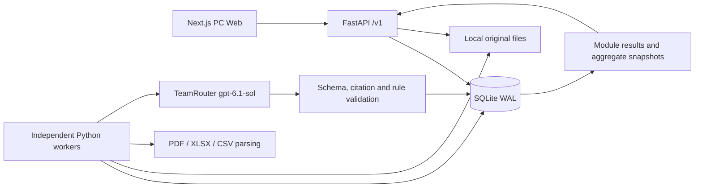

# Backend Architecture and Data Flow

This document describes the implemented local PC Web system. The original architecture and source materials remain in `deliverables/apexvibe5-handoff-v1/`. The runtime API contract is `contracts/openapi.json`.

## Components

FastAPI integrates Python document parsing and Pydantic validation. SQLite WAL supports the two-case demo, durable jobs, and transaction checks without Redis or Celery. API commands return 202 while workers parse files and call the model outside database transactions. One worker is sufficient; multiple workers can claim different jobs safely.

## Code and storage

| Component | Responsibility |
|---|---|
| api.py | HTTP, uploads, queries, English errors, CORS |
| models.py / contracts.py | Request/AI validation and runtime response schemas |
| service.py | Cases, parties, evidence, versions, adjustments, aggregation |
| worker.py | Durable jobs, leases, retries, parsing, AI execution, fenced commits |
| analyzer.py | TeamRouter chat/responses adapter, evidence-only prompt, provider metadata |
| parsers.py / field_sheets.py | PDF forms/text, spreadsheets, CSV, typed field mapping and differences |
| references.py / domain.py | Local reference selection, module facts, rule validation and scoring |
| db.py / migrations | SQLite persistence, transactions, immutable migrations |
| frontend/lib/backend-api.ts | Typed client, idempotency keys, optimistic versions and real file bytes |

Tables store cases, modules, module_runs, jobs, evidence, manual_adjustments, assessment_snapshots, audit_events, reference_records, and idempotency_records. Original files use server-generated storage identifiers; downloads verify case ownership and storage paths. Run inputs are immutable snapshots of the facts and references actually analyzed. There is no business deletion API.

## State and consistency

1. Create a case with independent buyer/seller selections. Upload a PDF and queue parsing.
2. Parse the real AcroForm; match companies by registration and jurisdiction. Skip still resolves an entity; unmatched companies become provisional. Resolve selected-company conflicts explicitly.
3. Start seven module runs and an initial-assessment batch. Each module has its own input and UI version.
4. Workers claim jobs in short transactions with a fencing token and lease heartbeat. File reads and model calls hold no write transaction.
5. Commit only when the worker still owns the lease and the input_version is current. New evidence makes older runs superseded instead of allowing stale results to overwrite newer inputs.
6. Once all initial runs reach succeeded, needs_info, failed, or superseded, the batch settles and the frontend automatically enters the result page.
7. Only seven current successful module results produce a current aggregate snapshot. Stale, failed, or missing inputs preserve historical results but withhold current financing.

module_version is the optimistic UI lock and changes with state updates. input_version changes only when analysis inputs change. Manual adjustments bind to a successful Run ID; after an AI rerun they require explicit review.

SQLite uses BEGIN IMMEDIATE and unique constraints to guard active jobs and evidence groups. Leases default to 120 seconds with approximately 20-second renewal. Timeouts, 408, 429, and 5xx allow at most three attempts. Expired jobs can recover after a restart; fencing prevents the old owner from committing. Provider calls cannot be guaranteed exactly once after a crash, even though business commits are protected.

## Evidence and AI

Each AI call receives one module's parsed invoice facts, relevant filtered local records, active supplementary evidence, sources, and policy rules. The model does not receive a target score, case label, or filename-based scoring instruction. Documents and notes are untrusted evidence rather than instructions.

The input contract explicitly states that facts originate from the main PDF, while evidence contains optional supplementary material. An empty evidence array does not mean the invoice is missing. Invoice field sheets are optional for the initial assessment; when active, their conflicts with the PDF must be considered.

The model returns status, an English summary, one matched rule, English findings with source IDs, and missing inputs. The server validates structure, allowed citations, required references, and rule membership. It maps the rule to points and computes financing; the AI does not supply an arbitrary total or approval.

Excel field sheets map the Field column to the Value column, independent of row ordering. Money, dates, integers, booleans, required fields, duplicate keys, arithmetic, and PDF differences are checked before analysis. Replacing a version requires an explicit evidence_group and supersedes_evidence_id in the same case/module/group. The new candidate activates atomically only after successful parsing. The previous version remains auditable, and only active evidence enters subsequent AI inputs.

Local records are filtered by the applicable company, company pair, product, currency, time window, and other comparison dimensions. Missing required local references produce needs_info through local validation without calling AI.

## Risk policy

| Module | Cap |
|---|---:|
| Invoice Integrity | 15 |
| Buyer Verification | 10 |
| Seller Verification | 10 |
| Buyer–Seller Relationship | 30 |
| Product & Market Price | 10 |
| Payment History | 15 |
| Duplicate Financing | 10 |

`module_final = clamp(AI + requested_adjustment, 0, cap)`. Effective adjustment is final minus AI; total risk is the sum of module finals. Higher is riskier. LOW < 30, HIGH ≥ 30. Confirmed invoice/company conflicts and duplicate financing remain hard blocks even if an analyst lowers the numerical score. Only a current LOW assessment without a hard block or pending adjustment review receives the indicative 80% advance.

Case 1 evaluates to 5/LOW (2 late payments out of 12). Case 2 evaluates to 35/HIGH (30 trade-scale risk + 5 payment risk). Its erroneous field sheet adds 15 integrity points; replacing it with a valid corrected sheet removes those points: **35 → 50 → 35**. Unrelated modules do not rerun or lose their findings.

The demo policy is demo-risk-v1, as of 2026-10-04. Scores are demonstrative policy points, not calibrated probabilities. Schema/citation validation does not prove factual correctness. Provider failures do not fall back to another model or a canned score.

## Scope

The provided commercial-invoice AcroForm template is supported, not arbitrary scanned invoice OCR. Supplementary files support text PDF, values-only XLSX, and UTF-8 CSV, with size/page/cell/context limits. Images, Word, and legacy XLS remain unavailable. A failed grouped replacement can recover through a valid correction; ungrouped failed evidence has no deletion workflow yet.

This is a local demo with a fixed analyst identity and synthetic data. There are no external registry/bank searches, authentication, multi-tenancy, production deployment, or actual financing transactions. The current frontend is English and desktop-only. Historical source documents and prior test records remain preserved.
