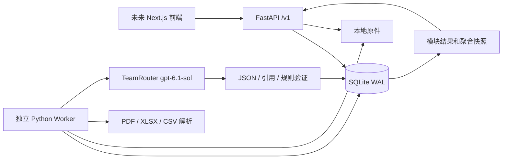

# 后端实现与数据流

版本：0.1.0。此文对应实际代码；完整业务背景、字段 JSON 及最初设计在 `deliverables/apexvibe5-handoff-v1/`。本轮不实现前端。

## 组件

选择 FastAPI 是为了以 Python 直接连接 PDF/Excel 解析、Pydantic 校验与异步任务 API。SQLite WAL 足够支持两个演示案例、持久化和并发状态保护；当前不需要额外 Redis/Celery。模型请求在 Worker 进程中执行，HTTP 请求返回 202，API 不等待模型完成。

## 目录职责

| 文件 | 职责 |
|---|---|
| `backend/src/apexdefend/api.py` | HTTP、文件接收、CORS、错误响应、查询 |
| `models.py` / `contracts.py` | 请求/AI 输出校验、实际 OpenAPI 响应契约 |
| `service.py` | Case、主体解析、证据、版本、人工调整与汇总事务 |
| `worker.py` | 队列消费、租约/重试、解析、AI 调用、提交保护 |
| `analyzer.py` | TeamRouter 协议适配、结构化 Prompt 与返回元数据 |
| `parsers.py` | 源文件校验、PDF AcroForm、补件内容抽取 |
| `domain.py` | 分模块输入、规则/引用验证、计分与融资演示规则 |
| `db.py` / `backend/migrations/` | SQLite 表、事务、冻结的版本迁移 |
| `scripts/live_case1.py` | 真实 HTTP + Worker + TeamRouter 验收 |

## 数据模型

| 表 | 内容 |
|---|---|
| cases | 主体选择/解析、规范化发票、Case revision、初评状态、最后有效结果 |
| modules | 七个独立状态、UI version、input version、已评估版本、当前运行指针 |
| module_runs | 每次输入快照、AI 输出、状态、provider/model/request ID/token usage |
| jobs | 持久任务、重试计数、租约、提交令牌、错误 |
| evidence | 原件索引、SHA-256、解析内容、文字说明、解析状态 |
| manual_adjustments | 请求调整、实际调整、原因、绑定运行、确认状态 |
| assessment_snapshots | 每次有效聚合的不可变结果及模块版本向量 |
| audit_events | 单调递增序号的业务事件与操作身份 |
| reference_records | 合成本地主体、交易、价格、付款及融资台账 |
| idempotency_records | 24 小时幂等键、请求哈希及原始响应 |

文件以服务端生成的 ID 存储，用户文件名仅用于展示；下载校验 Case 归属和存储路径。运行快照包含被引用的参考资料，使历史结果不依赖后来修改的数据。当前无删除业务接口，历史记录保留。

## 任务与一致性

1. 创建 Case，分别记录买卖方选择。上传 PDF 生成解析任务；初评由 API 显式启动。
2. 解析实际表单字段，按注册号和国家匹配本地实体；无匹配时创建 provisional entity。`Skip` 不代表缺失主体。
3. 初评生成七个独立 Run 和 Job，以及一个跟踪初评终态的批次。默认单 Worker 依次消费，也可启动多个 Worker。
4. Worker 用短事务领取 Job 并增加 fencing token。读取文件和调用 AI 时不持有数据库事务，定时续租。
5. 提交时同时检查租约归属和 `input_version`。期间有新资料时，旧运行变为 superseded；只有明确要求重跑时才排队处理最新资料。
6. 所有初始 Run 到达 succeeded / needs_info / failed / superseded 后，初评 settled，前端自动进入结果页。
7. 仅当七项当前版本均成功时生成新聚合快照。补件、失败或缺资料时保留旧快照供查看，当前融资状态为 pending。

`module_version` 用于按钮提交的乐观锁，每次状态变化会递增；`input_version` 只在影响分析的内容变化时递增。两个版本不能互相替代。人工调整绑定具体 Run，重跑后转 pending_review，不静默沿用。

SQLite 采用 `BEGIN IMMEDIATE` 短写事务及唯一索引，防止同模块同时有两个活动 AI Job。租约默认 120 秒，约 20 秒续约；超时、408、429、5xx 最多三次尝试，延迟 1/3 秒。进程重启后过期任务可领取；旧 Worker 无法覆盖新持有者的提交。模型计费请求无法保证 exactly-once，崩溃恢复可能重复调用，业务结果提交有保护。

## AI 与评分

模型接收当前模块事实、相关本地参考资料、原件/补件抽取内容及模块规则，返回 `status / summary / matched_rule_ids / findings / missing_inputs`。不把预期总分、Case 标签或文件名作为判断依据。文档及备注均被标记为不可信证据，不是系统指令。

后端校验 JSON、可引用来源及有效规则；模型不能任意提交总分或融资结论。有效规则映射到模块风险点数，正调整加风险、负调整减风险，单模块限于 0–cap。七项 cap 合计 100。

| 模块 | cap | Case 1 演示规则预期 |
|---|---:|---:|
| invoice_integrity | 15 | 0 |
| buyer_verification | 10 | 0 |
| seller_verification | 10 | 0 |
| relationship | 30 | 0 |
| market_price | 10 | 0 |
| payment_history | 15 | 5（12 次付款中 2 次迟付） |
| duplicate_financing | 10 | 0（仅限本地台账覆盖范围） |

`final = clamp(AI + requested adjustment, 0, cap)`；实际调整为 `final - AI`；总分为七个 final 之和。LOW < 30；HIGH ≥ 30。重复融资、主体/发票完整性明确冲突等硬阻断保留，即使人工降分也不能绕过。只有当前有效 LOW、无硬阻断和待确认调整时返回 eligible + 80% 演示额度。

本次参考时点固定为 2026-10-04，策略版本 `demo-risk-v1`。规则是演示策略，不是经过校准的风险概率。AI 判断仍可能出错，schema/引用校验不等于事实正确性验证。模型请求失败不会切换其他模型或回退预置结果。

## 范围边界

当前主发票解析器针对提供的 AcroForm 模板，非任意扫描发票 OCR。补件支持有文本的 PDF、无公式求值的 XLSX 和 UTF-8 CSV；XLS、Word、图片能力预留但不可用。Excel 解压大小、单元格数量、PDF 页数、文件大小、AI 上下文均有限额。解析失败显式阻止目标模块继续出分；有分组的失败替代可通过有效修正版恢复，普通无分组失败补件暂无删除接口。

本地单实例数据库、固定演示身份、无外部工商/银行/融资网络查询。后续生产化可替换持久队列、对象存储、数据库和身份系统，保留 Case/Module/Run 契约。

## 补充：本地数据与显式修正

已增加字段键映射、精确筛选本地参考资料及解析验证后的原子证据替代。接入 `evidence_group / supersedes_evidence_id`，展示 pending / active / failed / superseded 版本状态。完整说明与请求表见 [补充实现说明](local-data-and-replacement.md)。本轮仅本地测试；前后端联调后再上传 GitHub。
