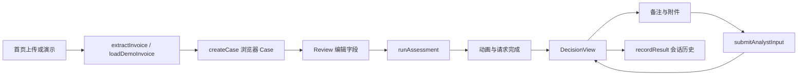

> 历史基线：本文件记录联调前的 Mock 原型。当前 Live 实现见 [联调说明](03-backend-integration.md)，真实结果见 [Live 验收](05-live-integration-verification.md)。

# 前端代码与功能梳理

检查日期：2026-10-04。对象：用户提供的 46 个原始文件。下文区分当前实现与联调所需改造，未把原包中的实施建议当作已完成能力。

产品范围已由用户确认：仅 PC 浏览器 Web 端。问题优先级和后续验收以 PC 场景为准，移动端适配不列入待办。

## 技术结构

| 项目 | 当前情况 |
|---|---|
| 框架 | Next.js 16.3.8，App Router，Turbopack |
| UI | React / React DOM 19.2.8、Tailwind CSS 4、lucide-react |
| 语言 | TypeScript strict，`@/*` 指向工程根目录 |
| 路由 | `/`、`/assessment/[id]`；默认 404 |
| 组件 / 工具 | 16 个组件，7 个 lib 文件 |
| 状态 | React state/ref + sessionStorage + 模块内存 |
| HTTP | `lib/api.ts`，浏览器直接请求后端，无 Next.js API 代理 |
| 原包测试 | 没有单元测试或 E2E 脚本；本次另做静态检查和浏览器验证 |
| 视觉 | 英语界面、深蓝背景、青色按钮、绿/黄/红状态 |

`layout.tsx` / Header 为服务端入口，首页、评估页和交互组件使用 Client Component。动态路由用 `useParams`；浏览器状态在客户端读取。Geist / Geist Mono 由 `next/font/google` 引入，构建会访问字体服务。工程内无数据库或业务服务实现。

## 页面与数据流

| 入口 | 当前行为 | 联调影响 |
|---|---|---|
| `app/page.tsx` | 抽取/生成发票，创建本地 Case，再导航 | 服务端创建 Case、主体选择、上传排队 |
| `app/assessment/[id]/page.tsx` | loading → missing/review/decision；点击评估进入 processing | API 恢复、解析/模块状态、轮询和错误 |
| Review | 原文件或演示排版 + 10 个文本字段 | 校验、字段修订保存、版本并发 |
| Processing | 初评约 8×380ms+250ms，动画结束后等待 Promise | 定时打勾不代表后端模块成功，需真实状态 |
| Decision | 总分、额度、完整度、7 模块、补件、版本差异 | nullable 分数、过期结果、后端决策 |
| 再评估 | 提交后等待完整下一版本；约 4×450ms+250ms 动画 | 补件和目标模块异步重跑 |
| Past evaluations | 当前浏览器会话列表 | 替换为服务端 Queue |

路由中的 `[id]` 是前端 `case-...`，不是后端 assessment ID；后者存在 `CaseState.assessmentId`，Mock 为四位随机数 `ASM-....`。从空白会话直接打开结果 URL 无法恢复记录。

## 组件职责

| 文件 | 职责 |
|---|---|
| Header | 品牌、Mock 标识、新建入口 |
| StepIndicator | 上传/确认/评估/结果四步 |
| InvoiceUploader | 单文件选择、拖放、15 MiB 限制、演示入口 |
| InvoicePreview | PDF embed / 图片 object URL / 原型排版 |
| InvoiceFieldsForm | 10 字段、来源提示、extracted/uncertain/missing/edited |
| ProcessingState | 定时阶段动画，独立于真实请求 |
| DecisionView | 结果编排、最高风险模块预选、补件与再评估 |
| AssessmentSummary | 融资建议、风险、预付比例和额度、完整度 |
| RiskScore | 分数变化动画 |
| ScoreChange | 版本分值、风险档位和模块摘要前后对比 |
| RiskDrivers | Medium/High 风险原因和核查建议 |
| RiskFactorCard | 模块折叠卡、贡献分和展示状态 |
| EvidencePanel | 检查项和文本证据 |
| MissingInformation | 原型 7 个完整性项目和补件入口 |
| AnalystInput | 模块选择、备注、多个附件、提交记录 |
| PastEvaluations | 会话 Case 列表与最新摘要 |

文件均位于 `components/`，后缀 `.tsx`。

## lib 与存储

| 文件 | 职责 |
|---|---|
| types.ts | 原型 ExtractedInvoice / Assessment / RiskModule 等类型 |
| api.ts | 4 个 Live HTTP 请求及 Mock 分支，另含本地 Demo 函数 |
| case-store.ts | Case CRUD、预览 URL、历史摘要 |
| format.ts | 金额/日期、风险和建议文案与颜色 |
| mock-data.ts | 虚构发票、参考记录和评分常量 |
| mock-engine.ts | 全量重算 7 模块、评分、完整度、版本快照 |
| mock-notes.ts | 英语关键词和文件名模拟证据解析 |

存储层：`apexvibe.cases` 保存本地 Case（Mock/Live 共用）；`apexvibe.mock.assessments` 保存 Mock 最新完整评估和 previous 摘要；内存 `previews` 保存 object URL。sessionStorage 通常可跨刷新、不能作为持久历史。object URL 刷新后丢失，当前没有 revokeObjectURL。

没有登录、跨设备历史、分页、检索、文件恢复、审计或真实任务队列。存储异常被捕获，当前页面部分行为可使用内存，刷新恢复仍依赖 sessionStorage。

## 文件、字段和模拟边界

主发票：PDF/PNG/JPG/JPEG/WebP，按 MIME 或扩展名任一匹配放行；上限 `15 * 1024 * 1024` 字节，页面未列出 WebP。HEIC/HEIF 提示转换。分析员附件选择器允许 PDF、PNG、JPG/JPEG、DOC/DOCX、XLS/XLSX、CSV，可多选，尚无独立大小、数量和内容校验。

10 个字段为 seller、buyer、buyer_registration、invoice_number、invoice_date、due_date、amount、currency、bank_account、po_reference。都是文本输入，没有必填、金额或日期语义校验；行项目不能编辑。

| 能力 | 当前边界 |
|---|---|
| 上传、字段编辑、导航、分值变化展示 | 浏览器真实交互 |
| Mock 上传抽取 | 不读取文件内容，返回固定值并标 `simulated=true` |
| Use Demo Invoice | 本地虚构发票，当前 `simulated=false`；Live 下仍走本地 |
| Mock 备注 | 英语关键词匹配，不能代表真实 AI 理解 |
| Mock 附件 | 按模块和文件名生成证据，不读取字节 |
| Mock 评分 | 贡献分求和上限 100；≤10 Low，11–25 Medium，>25 High |
| Mock 额度 | Low 80%；引擎按整数四舍五入，展示默认无小数 |
| 参考数据 | 主体、付款历史、银行账户均为虚构 |
| Live 分支 | 已有请求代码，尚未接通现有 `/v1` 后端 |

初始 23 分 = 银行未确认 16 + PO 4 + 付款 3。卖方确认备注后 9 分，补 PO 后 5 分。本次保留原业务逻辑与样式。

## 已知问题与处理位置

P0 表示对接现有后端前必须解决的差异，P1 表示真实数据接入需处理的正确性问题。

| 优先级 | 发现及影响 | 处理位置 |
|---|---|---|
| P0 | 路径、模块、类型、风险档位、决策不同 | [联调差异表](03-backend-integration.md) |
| P0 | Live 仍依赖会话 Case，无 API 恢复 | case-store、评估页、PastEvaluations |
| P0 | 不支持 queued/running/needs_info/failed/stale、分数 null | 新后端 DTO 与展示模型 |
| P0 | 无幂等 key、revision/version 校验、409 处理 | API 写入层 |
| P1 | `loadCase` 吞掉 GET 错误并返回 Review | 区分断网、404、503，避免再次评估 |
| P1 | request 无超时/取消/响应校验，JSON 失败退回 `{}` | transport 与运行时 Schema |
| P1 | 只读取 `body.detail`，无法显示 `error.message`；detail 数组变成不友好文本 | 统一错误解析 |
| P1 | 刷新后原件消失，退回固定地址、银行、subtotal/tax 的演示排版 | 通过 file_id 恢复原件；恢复前显示不可用 |
| P1 | 字段无校验，Mock 改金额/主体不会执行真实全套检查 | 表单校验与后端修订接口 |
| P1 | 假定 modules 非空、枚举都匹配；错误响应可导致 `[0].id` 等报错 | DTO 校验和空/错状态 |
| P1 | 金额默认无小数，Mock 额度丢小数 | 接收后端 Decimal 字符串、按币种格式化 |
| P1 | Live 仍有本地 Demo、原型阈值和模拟文案 | 按 engine_mode / policy_version 展示 |
| P1 | Mock/Live 共用 Case key | 按模式与服务实例隔离或完全服务端恢复 |
| P2 | Mock assessment ID 仅 9000 个随机值 | 演示可换 UUID，真实 ID 由后端返回 |
| P2 | object URL 未释放；证据用可能重复的 label 作 React key | 生命周期清理、稳定 evidence_id |

本次将这些事项列为后续工作，没有把原型评分策略迁移到后端，也没有进行页面重写。
